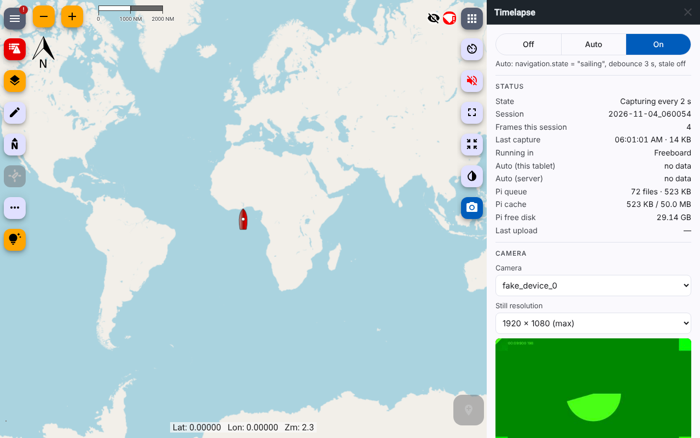
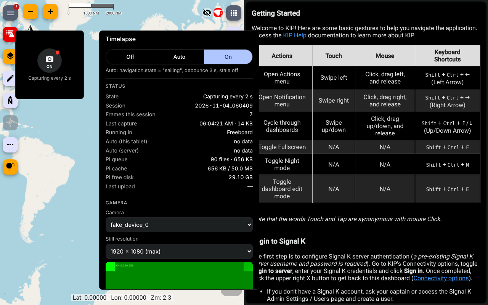
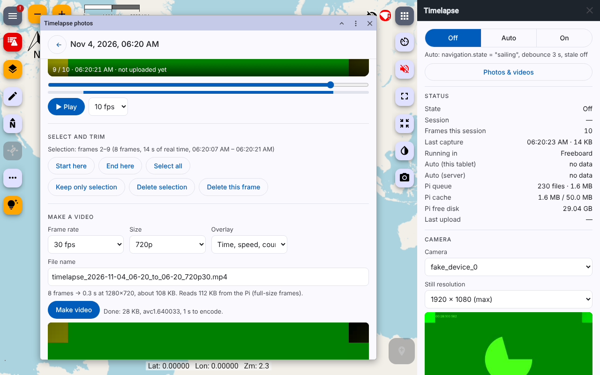

# Tablet Camera Timelapse

A Signal K plugin that takes timelapse photos with the tablet's camera at a fixed interval. Capture runs when you turn it on, or automatically while a Signal K path matches a value (for example `navigation.state` = `sailing`). Every frame is saved to the Pi's SD card first and then uploaded to Google Drive in the background. Uploads tolerate being offline and survive restarts.

It runs inside the apps you already use, with their own UI:

- **Freeboard-SK 3.4+:** a native plotter extension.
  - A toolbar button whose style shows the state and opens a settings panel in Freeboard's drawer.
  - An optional 1×1 chart widget.
  - Capture runs in a hidden background runtime, so it keeps going whichever panel is open.
- **KIP:** a page for KIP's **Embed Webpage** widget. It takes KIP's live theme (day, night, light) and shrinks to a single button in small tiles.
- **Anything else:** the same page works standalone at `/signalk-tablet-camera-timelapse/`.
- **Photos and videos** (from either): browse the photos on the Pi, play sessions back, trim or delete frames, and make MP4 timelapse videos in the browser with an optional time, speed and wind overlay.



No external binaries: no ffmpeg and no rclone. The only runtime dependency is `piexifjs`, used for EXIF.

## Install

Install **Tablet Camera Timelapse** from the Signal K App Store (or `npm i signalk-tablet-camera-timelapse` in `~/.signalk`), restart the server, then enable it under **Server → Plugin Config**.

## 1. Make the camera work: secure context

Chrome only allows the camera on HTTPS or on an origin you mark as trusted. Until then the panel and the KIP page show a warning with these steps. You have two options:

**(a) Chrome flag. Recommended for one dedicated tablet.**

1. On the tablet, open `chrome://flags/#unsafely-treat-insecure-origin-as-secure`.
2. Add `http://<pi-address>:3000` (exact scheme, host and port, for example `http://10.10.10.1:3000`).
3. Set it to **Enabled** and restart Chrome.

Use a fixed address (a DHCP reservation or the OpenPlotter hotspot IP). If the Pi's address changes, the flag stops matching.

**(b) HTTPS on the Signal K server.** Self-signed certificates are clumsy in Chrome: you get interstitials, and the camera prompt can still be refused. The clean way is a locally trusted CA (for example `mkcert`): install the CA certificate on the tablet under Android **Settings → Security → Encryption & credentials → Install a certificate → CA certificate**, then point Signal K at a certificate issued by it.

Chrome asks for camera permission once per origin. After that the camera opens with no tap needed.

## 2. Freeboard-SK

Enable the plugin and reload Freeboard. There's nothing to switch on inside Freeboard: it finds the extension through the server's `plotterExtensions` resources.

- **Toolbar button** (camera icon, map toolbar): opens the **Timelapse** panel in Freeboard's drawer. Its style shows the state in Freeboard's own colors:

  | Button | Meaning |
  |---|---|
  | normal | Off |
  | amber icon | Auto, waiting for the condition |
  | active (highlighted) | Capturing |
  | warning | Problem: camera denied, insecure context, Pi cache full, uploads failing, Drive not connected while frames are queued |
  | alarm | Pi disk space low, so frames are being rejected |

- **Panel:** the Off/Auto/On switch, live status, the capture interval and timestamp, camera and still-resolution pickers, **Take test photo**, and Google Drive connect and disconnect. It follows Freeboard's night mode.
- **Widget** (optional): press and hold an empty corner cell on the chart, then pick **Timelapse**. Tap the widget to cycle Off → Auto → On. Press and hold it to open the settings, which also has **Remove widget**.

Capture runs in Freeboard's background runtime, a hidden iframe that Freeboard keeps loaded while the plugin is enabled. It doesn't depend on the panel or widget being open.

## 3. KIP

Add an **Embed Webpage** widget to a dashboard:

1. URL: `/signalk-tablet-camera-timelapse/`
2. Turn on **Allow input**. Without it, KIP lays a transparent cover over the page and taps never reach the button.

The page copies KIP's theme colors and font from KIP itself and follows theme switches, night included. In a tile smaller than about 260×300 px it shows one round button: tap cycles the mode, and press and hold opens the full settings in the same tile. A bigger tile shows the full settings directly. Add `?view=compact` or `?view=full` to the URL to force a layout.



KIP unloads widgets on dashboards you aren't looking at, so this page only captures while its dashboard is showing. To capture from any dashboard, keep Freeboard loaded somewhere (KIP's own Freeboard widget counts). The engine handover below keeps one session going while you switch.

## 4. One capture engine per tablet

Every context that can capture competes for one lock in the browser (Web Locks): Freeboard's background runtime, the KIP page, the standalone page and the gallery page (so capture continues while you browse photos in a tab in front of KIP). The rules:

- **Only one engine runs on a tablet.** The other contexts are just UIs, and they talk to the engine over a same-origin BroadcastChannel.
- **The engine has to be visible.** An engine whose page is hidden (for example a tab in the background) steps down.
- **Handover:** when the engine goes away (you switch KIP dashboards or close a tab), the next visible candidate takes over within about a second and continues the same session.

The **Running in** row in the status list shows which context holds it. Several tablets each run their own engine. The mode (Off/Auto/On) is stored on the server and shared by all of them.

## 5. Photos and videos

Tap **Photos & videos** at the top of the settings. In Freeboard it opens in a floating window over the chart. From KIP or the standalone page it opens `/signalk-tablet-camera-timelapse/gallery.html` in a new tab.



- **Sessions:** every session on the Pi, newest first, with a thumbnail, its length and how many frames are still waiting to upload. The gallery shows what is on the Pi. With `afterUpload: move` (default) that is everything from the last `keepUploadedDays`. With `delete`, frames leave the Pi once they reach Drive.
- **Playback:** scrub or play a session from its thumbnails at 5–30 fps. Stop on a frame to load it sharp. The caption shows the time, speed and course from the frame's sidecar.
- **Select and trim:** **Start here** / **End here** mark a range. **Keep only selection** trims the session to it. **Delete selection** cuts it out. **Delete this frame** and **Delete whole session** do what they say. Each delete asks first. If the frames are already in Drive you can delete on the Pi only, or on both; Drive copies go to the Drive trash, where they can be restored for 30 days. Drive deletions are queued like uploads, so they also work while offline.
- **Make a video:** of the selection, at 12/24/30/60 fps and 720p up to 2160p (capped at the photo size), optionally with a time, speed, course and wind overlay. Encoding runs on the tablet with WebCodecs (H.264, VP9 if the device has no H.264 encoder) into an MP4; the Pi does no video work. The result plays in the page, and you can:
  - **Save to Pi (and Drive):** stored in `<storagePath>/videos/` and uploaded to the `videos` folder in Drive. Saved videos are listed under **Videos** in the gallery, where they can be played, downloaded or deleted.
  - **Download** or **Share…** (Android share sheet). Freeboard's extension frames are sandboxed without downloads, so inside Freeboard save to the Pi and download from the gallery page in a browser tab.

**HD proxies.** Pulling full-size 12 MP frames over boat Wi-Fi to make a 1080p video is slow: about 3 MB per frame. So after each frame, the tablet also stores a 320 px thumbnail and a 1920 px "HD proxy" (about 400 KB) on the Pi. They are never uploaded. Videos up to the proxy size are built from the proxies; larger ones read the originals. The gallery shows which before you start. Set `proxyWidth` to `0` to turn proxies off. Thumbnails and proxies are deleted with their frame, and they are not counted in `maxCacheMB`, which they exceed by roughly 13%.

The whole video is assembled in the tablet's memory before it is saved, so keep exports to a few hundred MB (the gallery shows the estimated size; 10 hours at a 10 s interval is about 2 minutes of 1080p30, roughly 120 MB).

## 6. Using it

The mode survives reloads and restarts according to `defaultMode`: Off, Auto or On at plugin start, or **Last used**.

### Settings in the app

Things you change often are in the app's settings (the Freeboard panel, the KIP page or the standalone page), not the server's plugin config:

| Setting | Where it is kept |
|---|---|
| **Interval** (1–3600 s) | On the Pi (`settings.json` in the plugin data folder), for every tablet. Takes effect on the next frame. The plugin config value is the default until you change it here. |
| **Timestamp on each photo**: off, or a corner | On the Pi, for every tablet. |
| **Camera** and **Still resolution** | On this tablet (browser storage), since they depend on its cameras. |

All of them survive reloads and restarts. Changing the Pi-side settings needs a read/write login. **Take test photo** takes one photo per press with the current camera, resolution and timestamp, saves it to the `test-shots` folder and shows it. There is no live preview, so the camera is only open while capturing or taking a test photo.

**Timestamp.** The tablet draws the capture time in its own time zone (for example `2026-11-04 14:23:05 PST`) on a dark box in the chosen corner, scaled to about 3.5% of the image's short side, before the frame is uploaded. It is in the file on the Pi and in Drive and can't be removed later. Stamping decodes and re-encodes each frame at `jpegQuality`, which on a 12 MP frame costs a few hundred ms on the tablet. EXIF time and GPS are still written on the Pi. The gallery's video overlay is separate, so turn one of them off if you don't want the time twice.

Capture pauses while the screen is off or another app is in front, and the status shows when the last pause happened. Keep the tablet plugged in with Freeboard or KIP in front. The engine holds a screen wake lock while it captures.

### Sessions

A session starts when capture starts and ends when it stops. The session ID is the tablet's local time, `YYYY-MM-DD_HHMMSS`. Frames go to one folder per session, on disk and in Drive. A reload, an engine handover or a brief Auto dropout resumes the same session if it happens within 5 minutes or 10 intervals, whichever is longer. Changing the mode always starts a new session. Test shots go to `test-shots/`.

### Storage estimate

At a 10 s interval you get 360 frames/hour. At about 3 MB per full-resolution frame (Highest on a 12 MP camera) that's about **1 GB/hour**; at the default Lowest it is closer to 50 MB/hour. The panel shows the estimate from your measured frame size. Size `maxCacheMB` and the SD card for the longest offline stretch you expect.

## 7. Auto mode

One comparison on one path, evaluated both in the browser (websocket subscription, which drives capture) and on the server (shown in `/status` for cross-checking):

- `autoPath`, for example `navigation.state`
- `autoOperator`: `equals` or `notEquals`
- `autoValue`: compared as a trimmed string, case-insensitive unless `autoCaseSensitive` is set
- `autoDebounceSeconds` (default 30): the condition must hold this long before capture starts or stops
- `autoStaleSeconds` (default 0, off): if no update arrives in this window, the condition is false

A missing path, a `null` value or stale data makes the condition false **immediately**, with no debounce, so capture never runs on missing data.

**Staleness and slow paths.** Many sources publish `navigation.state` only when it changes, so the staleness check is off by default. A 120 s window would stop Auto two minutes after every state change. For a path that updates continuously, such as `navigation.speedOverGround`, set something like `autoStaleSeconds: 120` so a dead sensor stops capture.

To test by hand, send a delta from any read/write client:

```json
{"context":"vessels.self","updates":[{"values":[{"path":"navigation.state","value":"sailing"}]}]}
```

## 8. Google Drive

The plugin uses the OAuth **device flow** with the `drive.file` scope. The app can only see files it creates. Google's docs list `drive.file` as allowed for the device flow and as a non-sensitive scope.

### Create OAuth credentials (one time, about 5 minutes)

1. Go to <https://console.cloud.google.com/> and create a project.
2. **APIs & Services → Library**: enable **Google Drive API**.
3. **Google Auth Platform → Branding/Audience** (the OAuth consent screen): choose user type **External** and fill in the app name and your email.
4. **Audience → Publish app**, to move it to **In production**. Do this. While an app is in *Testing*, Google expires its refresh tokens after **7 days**, and uploads would stop every week. `drive.file` is non-sensitive, so publishing needs no Google review. You'll see an "unverified app" warning when you approve, and that's expected.
5. **Clients → Create client**, application type **TVs and Limited Input devices**. Copy the client ID and secret.
6. In the plugin config, enable **Google Drive**, then paste the client ID and secret.

### Authorize

Open the Timelapse panel (or the KIP page) and tap **Connect Google Drive**. It shows a URL (`google.com/device`) and a code. Approve on your phone. The plugin polls Google itself, so you can close the panel. While it waits, the admin UI's plugin status also shows the URL and code.

The refresh token is stored in the plugin data dir as `drive-token.json` with mode `0600`, and it's never logged. **Disconnect** revokes it with Google and deletes the file.

A public npm package can't keep a client secret confidential, which is why you bring your own credentials.

### Drive layout

```
<drive.folderName>/            default "Signal K Timelapse"
  2026-11-03_093012/
    2026-11-03T16-30-12-345Z.jpg
    2026-11-03T16-30-12-345Z.json
  videos/                      videos saved from the gallery
```

## 9. On the Pi

```
<storagePath>/                 default <plugin data dir>/frames
  queue/<session>/*.jpg|json   waiting for upload (the filesystem is the queue)
  uploaded/<session>/...       after upload, in move/keep modes
  thumbs/<session>/*.jpg       gallery thumbnails (*.hd.jpg: HD proxies), never uploaded
  videos/*.mp4                 videos saved from the gallery (kept until you delete them)
  queue/videos/, uploaded/videos/   hard links to those videos for the Drive upload
```

- Writes are atomic (temp file, fsync, rename). `POST /frames` responds once the frame is on disk. A frame is identified by session plus capture timestamp, so a client retry after a lost response returns `200 duplicate` instead of storing a second copy.
- Frame filenames are UTC timestamps. The sidecar `.json` records capture time, position, SOG, COG, heading and wind, in Signal K SI units, snapshotted from the server at ingest. With `writeExif` on, GPS position, speed, track, heading and UTC time go into the JPEG EXIF as well.
- `afterUpload` options:
  - `move` (default): move to `uploaded/` and prune after `keepUploadedDays`.
  - `delete`: delete after upload.
  - `keep`: move to `uploaded/` and never prune.
- `minFreeDiskMB` (default 500): below this, frames are rejected with HTTP 507 and the dot turns yellow.
- `maxCacheMB` (default 1024) caps queued plus uploaded files. In `move` mode the oldest uploaded files are evicted first, since they're already in Drive. Capture stops only when *queued* frames alone fill the cap, and it resumes on its own once uploads catch up. In `keep` mode nothing is evicted, so the cap eventually stops capture. Set `maxCacheMB` to 0 for no cap.
- With Drive disabled, frames stay in `queue/` until the cache cap.
- Saved videos are hard-linked into `queue/videos/` for upload, so they take no extra space, and pruning or eviction only removes the link. They never count toward the frame cache cap, so a large video can't stop capture.

### Uploader behavior

- Every `uploadIntervalSeconds` (default 60), the uploader sends queued files oldest first, `uploadConcurrency` at a time. Files over 5 MB use a resumable upload streamed from disk.
- Drive deletions requested in the gallery are queued in `drive-deletes.json` and run at the start of each pass: files are found by their `appProperties` key, whole sessions by folder, and moved to the Drive trash.
- A full Drive (403 `storageQuotaExceeded`) stops the pass, shows `drive_full` in status and retries every 15 minutes.
- Network failures and Google 5xx errors stop the pass and back off exponentially, up to 15 minutes. Rate limits (429, or 403 `rateLimitExceeded`) back off with jitter and honor `Retry-After`. On a 401 the uploader refreshes the token once. If the refresh fails, status shows `needs_auth`.
- No duplicates after a crash: before each upload the plugin records the file in `inflight.json`. Files left there after a crash or a dropped connection are looked up in Drive by `appProperties` before being uploaded again. Normal uploads skip that extra call.
- Folder IDs are cached in `drive-folders.json`. If you delete a folder in Drive, the 404 clears the cache and the folder is recreated.
- The uploader sits behind a small interface (`init`, `ensureFolder`, `exists`, `upload`) in `src/drive/target.js`, so S3 or WebDAV targets can be added.

## 10. Signal K security

On Signal K 2.x, plugin routes are **admin-only unless the plugin declares otherwise**. This plugin declares:

| Route | Needs |
|---|---|
| `GET /config/client`, `/status`, `/mode`, `/drive/auth/poll`, `/sessions…`, `/videos…` | any logged-in user (or `allow_readonly`) |
| `PUT /mode`, `POST /frames`, `/thumbs`, `/videos`, deletes, `POST /drive/auth/start`, `/drive/auth/revoke`, `/drive/upload-now` | **read/write** or admin |

Log in on the tablet as a **read/write** user, or approve it as a read/write device. Freeboard and KIP sign in with the same server session cookie, which the extension and the page reuse for HTTP and the websocket. Give the tablet a long session: set token expiration to `NEVER` or several months under **Security → Settings**, otherwise capture stops when the login expires. The page and extension files are public, as the plotter-extension spec requires; Freeboard only *discovers* the extension through the authenticated resources API. If the tablet isn't logged in, the status says so.

I verified this on signalk-server 2.35.1:

| Login | Reads | Writes |
|---|---|---|
| none | 401 | 401 |
| readonly | 200 | 401 |
| read/write | 200 | 200/201 |

## 11. Signal K output

When `publishDeltas` is on, the plugin publishes:

- `plugins.tabletCameraTimelapse.mode`
- `plugins.tabletCameraTimelapse.capturing`: a frame arrived within the last 3 intervals or 30 s
- `plugins.tabletCameraTimelapse.queueLength`
- `plugins.tabletCameraTimelapse.sessionId`

The Signal K spec doesn't define a `plugins.*` branch. It's the common convention for plugin-specific state.

## REST API

All routes are under `/plugins/signalk-tablet-camera-timelapse/`. The Freeboard extension manifest is served as a read-only resource at `/signalk/v2/api/resources/plotterExtensions/signalk-tablet-camera-timelapse`.

| Method | Path | Notes |
|---|---|---|
| POST | `/frames?session=&ts=&mode=&device=&w=&h=` | raw `image/jpeg` body. Returns 201, 200 (`duplicate`), 400, 413, 415 or 507 (`disk_low` or `cache_full`) |
| GET/PUT | `/mode` | `{"mode":"off"\|"auto"\|"on"}` |
| GET/PUT | `/settings` | app settings `{"intervalSeconds", "stamp"}`. PUT takes a partial object; `null` resets a field to its default |
| GET | `/status` | mode, Auto evaluation, queue, cache, disk, Drive auth and uploader state, recent errors |
| GET | `/config/client` | config subset for the capture engine |
| POST | `/drive/auth/start` | starts the device flow and returns `userCode` and `verificationUrl` |
| GET | `/drive/auth/poll` | auth state (the plugin does the polling) |
| POST | `/drive/auth/revoke` | revokes and deletes the token |
| POST | `/drive/upload-now` | runs an upload pass now |
| POST | `/thumbs?session=&ts=&kind=thumb\|hd` | gallery thumbnail or HD proxy from the capture engine |
| GET | `/sessions` | sessions and saved videos on the Pi |
| GET | `/sessions/:id` | one session's frames with time, state and sidecar summary |
| GET | `/sessions/:id/frames/:name?size=thumb\|hd\|full` | a frame; `thumb`/`hd` fall back to `full`. `&download=1` for an attachment |
| POST | `/sessions/:id/delete` | `{"frames": [names], "drive": bool}` |
| DELETE | `/sessions/:id?drive=1` | delete a whole session (and trash its Drive folder) |
| GET | `/videos`, `/videos/:name` | list or fetch saved videos |
| POST | `/videos?name=` | raw `video/mp4` or `video/webm` body, streamed to disk, queued for Drive |
| DELETE | `/videos/:name?drive=1` | delete a saved video (and its Drive copy) |

## Tablet notes and open items

- **Still resolution.** The picker offers **Lowest** (the default) and **Highest**, which follow whichever camera is in use, then each exact size the current camera offers. An exact size is remembered for that camera only. On a 12 MP sensor Lowest is about 1000 × 750 (a quarter of the width, roughly 150 KB a frame), which caps video exports at that size; pick Highest or an exact size if you want 1080p or 4K timelapses.
- **How stills are taken.** The engine prefers `ImageCapture.takePhoto()` at the chosen size and falls back to grabbing a frame from the video stream into a canvas. Some cameras ignore the requested size and return full resolution, so below the maximum the engine checks and scales the still down. **Take test photo** reports the real size, the method used (`takePhoto` or `canvas`) and the latency. Use it on the Tab Active4 Pro to confirm `takePhoto` gives full sensor resolution in Chrome at Highest. `jpegQuality` applies when the browser encodes the image (the canvas fallback, or a still it scaled down). Other `takePhoto` JPEGs come from the camera pipeline as they are.
- **Camera inside Freeboard and KIP iframes.** Neither app's iframes set `allow="camera"`, and none need to: the server sends no Permissions-Policy, so Chrome's default allows the camera in same-origin frames, Freeboard's sandboxed extension frames included. I tested this in Chromium with permission already granted. The first-time permission prompt from inside the hidden Freeboard runtime still needs a check on the tablet. If it doesn't appear, grant the camera once from the standalone page at `/signalk-tablet-camera-timelapse/`; the permission is per origin, so Freeboard then has it too.
- **Night mode.** Test photos and gallery images are dimmed in night mode.
- **Video export on the tablet.** Tested with Chromium's H.264 encoder (`avc1.640033`). Chrome on Android normally has a hardware H.264 encoder; if not, the gallery falls back to VP9 or says no encoder fits and suggests a smaller size. Check one 1080p export on the Tab Active4 Pro.
- **Power.** The camera stays open in On and Auto modes, including while Auto waits, so focus and exposure stay settled. In Off mode, or while the page is hidden, the camera is closed.

## Development

```
npm install
npm test        # node:test: Auto comparator, storage, uploader, Drive client, EXIF, manifest, status logic
npm run lint    # syntax check, including the browser ES modules
```

Browser code has no build step. `public/js/core/` holds the host-agnostic engine, camera, protocol and shared UI; `public/js/hosts/` the Freeboard and KIP adapters. `public/vendor/` holds the ES module builds of [`signalk-plotterext-bus`](https://github.com/joelkoz/signalk-plotterext-bus) (MIT) and [`mp4-muxer`](https://github.com/Vanilagy/mp4-muxer) (MIT), each with its `VERSION` and `LICENSE`.

Run it against a local server by symlinking this repo into `~/.signalk/node_modules/` and adding it to `~/.signalk/package.json`.

## License

MIT
