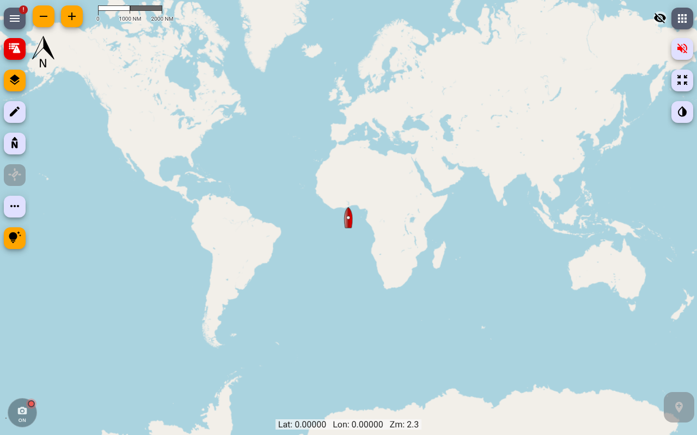

# Tablet Camera Timelapse

A Signal K server plugin and web app. It shows any installed Signal K web app (default Freeboard-SK) full screen in an iframe, and uses the tablet's camera to take timelapse photos at a fixed interval. Capture runs when you turn it on, or automatically while a Signal K path matches a value (for example `navigation.state` = `sailing`). Every frame is saved to the Pi's SD card first and then uploaded to Google Drive in the background. Uploads tolerate being offline and survive restarts.



No external binaries: no ffmpeg and no rclone. The only dependency is `piexifjs`, used for EXIF.

## Install

Install **Tablet Camera Timelapse** from the Signal K App Store (or `npm i signalk-tablet-camera-timelapse` in `~/.signalk`), restart the server, then enable it under **Server → Plugin Config**.

Open the wrapper at `http://<pi>:3000/signalk-tablet-camera-timelapse/` on the tablet.

## 1. Make the camera work: secure context

Chrome only allows the camera on HTTPS or on an origin you mark as trusted. The wrapper shows a banner if the page isn't a secure context. You have two options:

**(a) Chrome flag. Recommended for one dedicated tablet.**

1. On the tablet, open `chrome://flags/#unsafely-treat-insecure-origin-as-secure`.
2. Add `http://<pi-address>:3000` (exact scheme, host and port, for example `http://10.10.10.1:3000`).
3. Set it to **Enabled** and restart Chrome.

Use a fixed address (a DHCP reservation or the OpenPlotter hotspot IP). If the Pi's address changes, the flag stops matching.

**(b) HTTPS on the Signal K server.** Self-signed certificates are clumsy in Chrome: you get interstitials, and the camera and install prompts can still be refused. The clean way is a locally trusted CA (for example `mkcert`): install the CA certificate on the tablet under Android **Settings → Security → Encryption & credentials → Install a certificate → CA certificate**, then point Signal K at a certificate issued by it.

Chrome asks for camera permission once. After that, the wrapper opens the camera on load with no tap needed.

## 2. Install to the home screen (optional)

In Chrome, use **⋮ → Add to Home screen / Install app**, or the **Install app** button in the settings drawer. The installed app launches with no browser UI (`displayMode`, default `fullscreen`).

I tested installability on desktop Chromium. With option (a), the origin counts as secure, the service worker registers, and Chrome reports no installability errors. Without the flag, Chrome reports `not-from-secure-origin`. I haven't verified this on the Tab Active4 Pro. If Android only offers a plain shortcut rather than a full install, use HTTPS with a trusted local CA (option b).

When the page runs in a normal tab and `displayMode` is `fullscreen`, the first tap anywhere enters full screen. That tap is caught by a transparent layer and doesn't reach the chart. The layer re-arms after you leave full screen.

If you change `displayMode` or `orientation` after installing, you may need to uninstall and reinstall. Chrome refreshes installed manifests lazily.

## 3. Using it

The round camera button sits in the **bottom-left** corner by default (`buttonCorner`). Freeboard-SK uses the top-left for its menu and the bottom-right for its drop-waypoint button. Only the button takes touches, so chart pan and zoom pass straight through.

- **Tap** to cycle Off → Auto → On. Auto is skipped if `autoPath` is empty.
- **Long-press** to open the settings drawer.

Status dot colors:

| Dot | Meaning |
|---|---|
| grey | Off |
| amber | Auto, waiting for the condition, or paused |
| red, pulsing | Capturing |
| yellow | Problem: camera denied, insecure context, Pi cache full or disk low, uploads failing, or Drive not authorized while frames are queued |

The drawer contains:

- the mode switch
- live status from the tablet and the server: session, frames, last capture, Auto evaluation on both sides, queue, cache, free disk, last upload, Drive state
- a camera picker and a still-resolution picker, both remembered per tablet
- a live preview and a **Test shot** button
- the hosted-app switcher
- Google Drive connect and disconnect
- the install and full-screen buttons

The mode is stored on the server, so it's shared across tablets and survives page reloads. `defaultMode` sets the mode when the plugin starts. **Last used** restores whatever was set before a restart.

Capture pauses while the page is hidden (screen off, another app in front). The wrapper tells you when it resumes. Keep the tablet plugged in with the wrapper in front. The wrapper holds a screen wake lock while it captures.

### Sessions

A session starts when capture starts and ends when it stops. The session ID is the tablet's local time, `YYYY-MM-DD_HHMMSS`. Frames go to one folder per session, on disk and in Drive. A reload or short interruption, up to 5 minutes or 10 intervals, whichever is longer, resumes the same session. Test shots go to `test-shots/`.

### Storage estimate

At a 10 s interval you get 360 frames/hour. At about 3 MB per full-resolution frame that's about **1 GB/hour**. The drawer shows the estimate from your measured frame size. Size `maxCacheMB` and the SD card for the longest offline stretch you expect.

## 4. Auto mode

One comparison on one path, evaluated both in the browser (websocket subscription, which drives capture) and on the server (shown in `/status` for cross-checking):

- `autoPath`, for example `navigation.state`
- `autoOperator`: `equals` or `notEquals`
- `autoValue`: compared as a trimmed string, case-insensitive unless `autoCaseSensitive` is set
- `autoDebounceSeconds` (default 30): the condition must hold this long before capture starts or stops
- `autoStaleSeconds` (default 120): if no update arrives in this window, the condition is false

A missing path, a `null` value or stale data makes the condition false **immediately**, with no debounce, so capture never runs on missing data.

**Watch out for staleness on slow paths.** Many sources publish `navigation.state` only when it changes. With the default 120 s staleness window, Auto stops two minutes after the last change. For paths like that, set `autoStaleSeconds` to `0` to disable the check, or use a path that updates continuously.

To test by hand, send a delta from any read/write client:

```json
{"context":"vessels.self","updates":[{"values":[{"path":"navigation.state","value":"sailing"}]}]}
```

## 5. Google Drive

The plugin uses the OAuth **device flow** with the `drive.file` scope. The app can only see files it creates. Google's docs list `drive.file` as allowed for the device flow and as a non-sensitive scope.

### Create OAuth credentials (one time, about 5 minutes)

1. Go to <https://console.cloud.google.com/> and create a project.
2. **APIs & Services → Library**: enable **Google Drive API**.
3. **Google Auth Platform → Branding/Audience** (the OAuth consent screen): choose user type **External** and fill in the app name and your email.
4. **Audience → Publish app**, to move it to **In production**. Do this. While an app is in *Testing*, Google expires its refresh tokens after **7 days**, and uploads would stop every week. `drive.file` is non-sensitive, so publishing needs no Google review. You'll see an "unverified app" warning when you approve, and that's expected.
5. **Clients → Create client**, application type **TVs and Limited Input devices**. Copy the client ID and secret.
6. In the plugin config, enable **Google Drive**, then paste the client ID and secret.

### Authorize

Open the drawer and tap **Connect Google Drive**. It shows a URL (`google.com/device`) and a code. Approve on your phone. The plugin polls Google itself, so you can close the drawer. While it waits, the admin UI's plugin status also shows the URL and code.

The refresh token is stored in the plugin data dir as `drive-token.json` with mode `0600`, and it's never logged. **Disconnect** revokes it with Google and deletes the file.

A public npm package can't keep a client secret confidential, which is why you bring your own credentials.

### Drive layout

```
<drive.folderName>/            default "Signal K Timelapse"
  2026-11-03_093012/
    2026-11-03T16-30-12-345Z.jpg
    2026-11-03T16-30-12-345Z.json
```

## 6. On the Pi

```
<storagePath>/                 default <plugin data dir>/frames
  queue/<session>/*.jpg|json   waiting for upload (the filesystem is the queue)
  uploaded/<session>/...       after upload, in move/keep modes
```

- Writes are atomic (temp file, fsync, rename). `POST /frames` responds once the frame is on disk.
- Frame filenames are UTC timestamps. The sidecar `.json` records capture time, position, SOG, COG, heading and wind, in Signal K SI units, snapshotted from the server at ingest. With `writeExif` on, GPS position, speed, track, heading and UTC time go into the JPEG EXIF as well.
- `afterUpload` options:
  - `move` (default): move to `uploaded/` and prune after `keepUploadedDays`.
  - `delete`: delete after upload.
  - `keep`: move to `uploaded/` and never prune.
- `minFreeDiskMB` (default 500): below this, frames are rejected with HTTP 507 and the dot turns yellow.
- `maxCacheMB` (default 1024) caps queued plus uploaded files. In `move` mode the oldest uploaded files are evicted first, since they're already in Drive. Capture stops only when *queued* frames alone fill the cap, and it resumes on its own once uploads catch up. In `keep` mode nothing is evicted, so the cap eventually stops capture. Set `maxCacheMB` to 0 for no cap.
- With Drive disabled, frames stay in `queue/` until the cache cap.

### Uploader behavior

- Every `uploadIntervalSeconds` (default 60), the uploader sends queued files oldest first, `uploadConcurrency` at a time. Files over 5 MB use a resumable upload.
- Network failures and Google 5xx errors stop the pass and back off exponentially, up to 15 minutes. Rate limits (429, or 403 `rateLimitExceeded`) back off with jitter and honor `Retry-After`. On a 401 the uploader refreshes the token once. If the refresh fails, status shows `needs_auth`.
- No duplicates after a crash: before each upload the plugin records the file in `inflight.json`. Files left there after a crash or a dropped connection are looked up in Drive by `appProperties` before being uploaded again. Normal uploads skip that extra call.
- Folder IDs are cached in `drive-folders.json`. If you delete a folder in Drive, the 404 clears the cache and the folder is recreated.
- The uploader sits behind a small interface (`init`, `ensureFolder`, `exists`, `upload`) in `src/drive/target.js`, so S3 or WebDAV targets can be added.

## 7. Signal K security

On Signal K 2.x, plugin routes are **admin-only unless the plugin declares otherwise**. This plugin declares:

| Route | Needs |
|---|---|
| `GET /config/client`, `/status`, `/mode`, `/manifest.webmanifest`, `/webapps`, `/drive/auth/poll` | any logged-in user (or `allow_readonly`) |
| `PUT /mode`, `POST /frames`, `POST /drive/auth/start`, `/drive/auth/revoke`, `/drive/upload-now` | **read/write** or admin |

Log in on the tablet as a **read/write** user, or approve it as a read/write device. The wrapper uses the same-origin session cookie for HTTP and the websocket. Give the tablet a long session: set token expiration to `NEVER` or several months under **Security → Settings**, otherwise capture stops when the login expires. The web app's static files are public. If the tablet isn't logged in, the wrapper shows a banner with a login link.

I verified this on signalk-server 2.35.1:

| Login | Reads | Writes |
|---|---|---|
| none | 401 | 401 |
| readonly | 200 | 401 |
| read/write | 200 | 200/201 |

The manifest is fetched with `crossorigin="use-credentials"` so the install prompt works with security on.

## 8. Signal K output

When `publishDeltas` is on, the plugin publishes:

- `plugins.tabletCameraTimelapse.mode`
- `plugins.tabletCameraTimelapse.capturing`: a frame arrived within the last 3 intervals or 30 s
- `plugins.tabletCameraTimelapse.queueLength`
- `plugins.tabletCameraTimelapse.sessionId`

The Signal K spec doesn't define a `plugins.*` branch. It's the common convention for plugin-specific state.

## REST API

All routes are under `/plugins/signalk-tablet-camera-timelapse/`.

| Method | Path | Notes |
|---|---|---|
| POST | `/frames?session=&ts=&mode=&device=&w=&h=` | raw `image/jpeg` body. Returns 201, 400, 413, 415 or 507 (`disk_low` or `cache_full`) |
| GET/PUT | `/mode` | `{"mode":"off"\|"auto"\|"on"}` |
| GET | `/status` | mode, Auto evaluation, queue, cache, disk, Drive auth and uploader state, recent errors |
| GET | `/config/client` | config subset for the wrapper |
| GET | `/manifest.webmanifest` | PWA manifest built from config |
| POST | `/drive/auth/start` | starts the device flow and returns `userCode` and `verificationUrl` |
| GET | `/drive/auth/poll` | auth state (the plugin does the polling) |
| POST | `/drive/auth/revoke` | revokes and deletes the token |
| POST | `/drive/upload-now` | runs an upload pass now |

## Tablet notes and open items

- **Still resolution.** The wrapper prefers `ImageCapture.takePhoto()` at the chosen size and falls back to grabbing a frame from the video stream into a canvas. The drawer's **Test shot** reports the real size, the method used (`takePhoto` or `canvas`) and the latency. Use it on the Tab Active4 Pro to confirm `takePhoto` gives full sensor resolution in Chrome. `jpegQuality` only applies when the browser encodes the image (the canvas fallback). `takePhoto` JPEGs come from the camera pipeline as they are.
- **Freeboard in the iframe** gets `allow="fullscreen; geolocation"`. The camera stays in the parent page. Freeboard's host API for embedded mode is left alone.
- **Power.** The camera stays open in On and Auto modes, including while Auto waits, so focus and exposure stay settled. In Off mode, or while the page is hidden, the camera is closed.

## Development

```
npm install
npm test        # node:test unit tests: Auto comparator, storage, uploader, Drive client, EXIF
```

Run it against a local server by symlinking this repo into `~/.signalk/node_modules/` and adding it to `~/.signalk/package.json`.

## License

MIT
